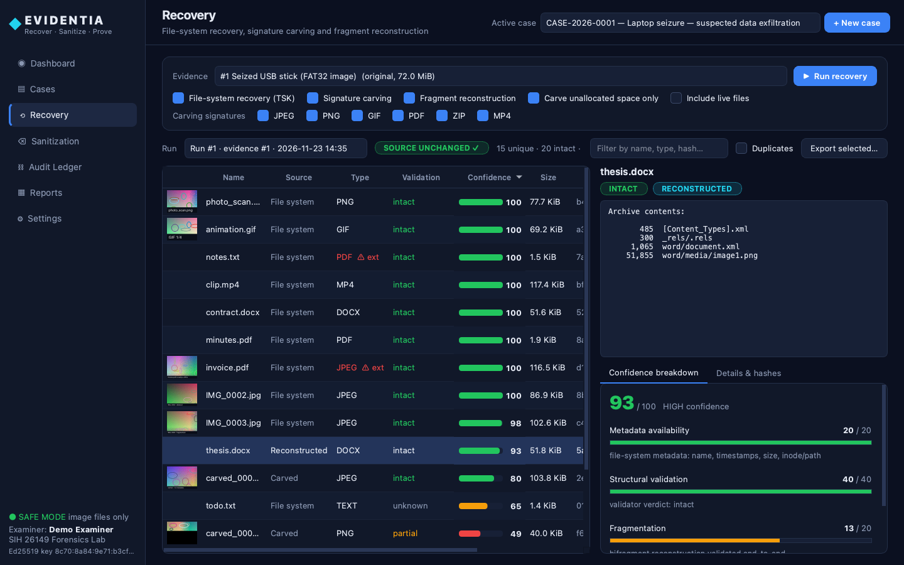

# Evidentia

**Digital forensics platform: advanced file recovery + secure data sanitization, connected by a shared,
tamper-evident forensic core.** Hackathon prototype for SIH problem 26149 (Blockchain & Cybersecurity).



| Module | What it does |
|---|---|
| **Recovery** | File-system-aware undelete via The Sleuth Kit (FAT/NTFS/ext/HFS+/exFAT), signature carving (JPEG, PNG, GIF, PDF, ZIP/DOCX/XLSX/PPTX, MP4, plus a pluggable table), structure-based validation, bifragment reconstruction, content-based classification with extension-mismatch flags, and a 0–100 confidence score with a breakdown |
| **Sanitization** | NIST SP 800-88 Rev. 2 Clear (zero / random / multi-pass) and Purge (ATA Secure Erase, NVMe Sanitize block/crypto, cryptographic erase; simulated on images, guarded commands on devices). Works on whole images/devices, partitions, or files/folders, with HDD vs SSD/NVMe/USB guidance, sample or full read-back verification, and Ed25519-signed certificates (PDF + JSON) |
| **Forensic core** | Cases, evidence, examiners and notes; chain of custody for every action; an append-only, hash-chained, signed **audit ledger** with pinpoint tamper detection and an exportable chain-head anchor; SHA-256 + MD5 of evidence before and after work and of every recovered file; PDF/HTML case reports |

The GUI (PySide6, dark dashboard) and the CLI are thin layers over the same `forensic.service.Evidentia`
facade, so every action from either one is recorded in the same ledger.

---

## Quick start

```bash
python3.12 -m venv .venv && source .venv/bin/activate      # Python 3.11+ (3.12 recommended)
pip install -r requirements.txt
brew install e2fsprogs            # macOS, for the ext4 test image (Linux: apt install e2fsprogs)

python scripts/make_test_images.py test_images      # FAT32, ext4, MBR disk (+ NTFS if ntfs-3g exists)
python -m evidentia.cli --home demo_workspace demo --fresh     # full end-to-end flow; answer y, then CONFIRM
#   non-interactive: printf 'y\nCONFIRM\n' | python -m evidentia.cli --home demo_workspace demo --fresh
EVIDENTIA_HOME=demo_workspace python -m evidentia               # open the GUI on that workspace
pytest                                                          # 124 tests
```

`python -m evidentia` starts the GUI. `python -m evidentia.cli <command>` is the CLI: `devices`, `case`,
`evidence`, `recover`, `report`, `sanitize`, `verify-ledger`, `anchor`, `verify-cert`, `make-images`, `demo`.
The default workspace is `~/.evidentia`; override it with `EVIDENTIA_HOME` or `--home`.

---

## Demo script for judges (about 5 minutes)

Run `python -m evidentia.cli --home demo_workspace demo --fresh` first (it creates everything below), then
open the GUI with `EVIDENTIA_HOME=demo_workspace python -m evidentia`. To do it live instead, create a new
case and follow the same steps.

1. **Dashboard.** "Safe mode: image files only" banner, stat cards, and the custody activity feed.
2. **Cases.** `CASE-2026-0001`, the original image (protected) with SHA-256/MD5, a hash-verified working
   copy, and a note. *Re-verify hash* re-hashes the evidence and records the check in the ledger.
3. **Recovery.** Select the FAT32 evidence and click **Run recovery**. The job runs on a worker thread
   with a progress bar and Cancel. Then point out:
   * `SOURCE UNCHANGED ✓`: SHA-256 of the evidence before and after the run are identical.
   * `invoice.pdf` is detected as **JPEG**, and `notes.txt` as **PDF**: red `⚠ ext` mismatch flags.
   * `thesis.docx` (**Reconstructed**): a deleted DOCX split around a 9-cluster gap. File-system recovery
     returns garbage, so the carver bridged the gap using the ZIP central directory and per-entry CRC-32
     checks. Its name and timestamps come from the FAT entry. Confidence 93, with fragmentation 13/20.
   * `IMG_0004.jpg`: overwritten in place. It is reported **corrupt** (46) and deliberately *not*
     "reconstructed" (see the Huffman check below).
   * `carved_…19a000.jpg`: an orphaned photo with no directory entry. Only carving finds it, so it gets
     80 points and 0 for metadata.
   * Click any row for the preview (image / PDF page / archive listing / hex), the score breakdown, and
     the details tab (fragments, offsets, timestamps, hashes).
4. **Reports.** *Generate case report* produces a PDF + HTML with the evidence summary, the recovered-file
   table (thumbnails, confidence, SHA-256/MD5), source integrity, the custody timeline and ledger status.
5. **Sanitization.** Target *Evidence working copy*, media *Disk image*. Pick *Single-pass random
   overwrite*, keep **Dry run** checked, and run it to see the plan. Uncheck Dry run and press the red
   **ERASE & VERIFY** button. **Step 1** is a Yes/No dialog listing the target, path, size, device type,
   method and NIST category with a "This cannot be undone" warning (Cancel is the default; Esc and
   closing also cancel). **Step 2** asks you to type `CONFIRM`; *Start Cleaning* stays disabled until it
   matches exactly. Only then does the job start, giving **PASS** (full read-back:
   72/72 blocks, 0 mismatches) and a signed certificate. Every step is in the Audit Ledger. *Verify signature* confirms it. Switch the media
   to **NVMe** to show the flash warning and the Purge options; on images they are simulated.
   Trying to target the *original* evidence is refused.
6. **Audit Ledger.** Click **Verify ledger integrity** (green). Then **Tamper demo**: it copies the database,
   edits entry #5 the way an attacker would (dropping the append-only trigger), and verification marks
   entry #5 red with the reason. The live ledger is untouched. **Export chain head** writes a signed
   anchor JSON (head hash + Merkle root) for publishing externally.
7. **Settings.** Advanced device access is off by default; enabling it requires typing `I UNDERSTAND`.
   The device table shows the boot disk as `REFUSED — system/boot disk; has mounted volume(s)`.

---

## Architecture

```
evidentia/
  core/        config, read-only EvidenceSource, streaming hashing, entropy, device safety policy, JobContext
  recovery/    signatures (pluggable) · validators · classifier · carver · fragments · fs_recovery (pytsk3)
               · scoring · engine (FS → carve → reconstruct → correlate → score → export)
  sanitize/    media (NIST catalogue + guidance) · patterns (seekable ChaCha20, AES-CTR crypto-erase sim)
               · engine (targets, safety gates, overwrite, purge, verification) · purge (guarded firmware cmds)
               · certificate (signed JSON + PDF)
  forensic/    db (SQLite) · ledger (hash chain + Ed25519) · keys · service (facade = chain of custody)
               · reports (PDF/HTML) · pdfstyle
  gui/         PySide6 main window, worker threads, pages: dashboard, cases, recovery, sanitize, ledger,
               reports, settings
  testdata/    deterministic FAT32 builder, ext4/MBR/NTFS generators, sample content
  cli.py       headless interface + `demo`
scripts/       make_test_images.py, screenshots.py
tests/         124 pytest tests (generated images; checked against the ground-truth manifest)
```

### Safety model (non-negotiable requirements)
* **Images by default.** `EvidenceSource` accepts regular files. Block/char devices need the *advanced*
  flag (Settings toggle or `--advanced`).
* **System and mounted disks are refused.** Detected with `diskutil` (macOS, including APFS containers
  mapped back to their physical store) or `lsblk` (Linux). A partition path such as `/dev/rdisk4s1` maps
  to its whole disk before the check.
* **Two-step erase confirmation, enforced in the core** (`sanitize/confirmation.py`). Every destructive
  run (image, partition, files/folders, device) needs an `ErasureAuthorization`. Only a
  `ConfirmationSession` that has passed both steps can create one: step 1 is an explicit *Yes, continue*
  after a summary with a "This cannot be undone" warning, and step 2 is typing exactly `CONFIRM`
  (case-sensitive; no surrounding spaces accepted). The token is tied to the exact target and method,
  single-use and valid for 10 minutes. `SanitizeEngine.run()` and `Evidentia.sanitize()` raise
  `ConfirmationRequired` without it, so the GUI, CLI and background jobs cannot skip it. Every step
  (shown, Yes/Cancel, typed passed/failed, started/aborted) goes to the ledger with operator and
  timestamp. GUI: two modal dialogs. CLI: `Proceed with this erase? [y/N]` (default N), then
  `Type CONFIRM to proceed:`. Tests use `evidentia.sanitize.testing.authorize_for_tests`, which
  refuses to run outside pytest. Physical devices *additionally* require typing the device name
  (`disk4`, `sdb`). **Dry run is the default** in both the GUI and the CLI (`--execute` is needed to
  write), and dry runs need no confirmation because they write nothing.
* **Evidence is never written.** Sources are opened `O_RDONLY`, the class has no write method, TSK reads
  through it, and every recovery run hashes the source before and after. Evidence registered as
  *original* cannot be a sanitization target: sanitize a hash-verified working copy instead.
* File-level sanitization refuses `/`, the home directory and system locations.

### Recovery pipeline
1. **File system (pytsk3):** detects MBR/GPT partitions, walks each FS (including `$OrphanFiles`), and
   extracts deleted regular files with names, inode, MAC times and data runs. Live files are optional.
2. **Carving:** a single compiled regex over all headers, scanned in 16 MiB chunks with overlap and
   sector alignment. Optionally only unallocated space (live files' runs are excluded). The end of each
   file is found *structurally* (JPEG marker walk, PNG IEND, GIF trailer, ZIP EOCD consistent with its
   central directory, MP4 box walk, PDF `%%EOF` with incremental updates). Footer + max size is the
   fallback; the signature table is extensible through JSON (`recover --signatures`).
3. **Validation** (`intact` / `partial` / `corrupt` / `unknown`): JPEG segment walk, byte stuffing, RST
   order, zero-run detection and an **exact baseline Huffman decode** (every MCU must decode, with only
   1-bit padding left), then Pillow decode. PNG: chunk CRCs + IDAT inflate + size. GIF: block walk +
   decode of all frames. PDF: xref offsets → `n g obj`, ASCII85/Flate streams inflate. ZIP/OOXML: EOCD,
   central directory, local headers, per-entry inflate + CRC-32. MP4: box sizes, `ftyp`/`moov`/`mvhd`/`mdat`.
4. **Bifragment reconstruction** (`fragments.py`):
   * *ZIP*: the central directory gives the true length, so the gap size is known. Only the split point
     is searched, and each candidate is accepted only if every entry's CRC-32 matches.
   * *JPEG*: the split is the first cluster that is not plausible entropy-coded data; the tail start is
     then searched cluster by cluster. A candidate must pass the full validator, including the exact
     Huffman decode. Tails inside another intact JPEG that starts in the gap are rejected: same-camera
     JPEGs otherwise splice "successfully" because Huffman decoding resynchronises (found and fixed
     during testing).
5. **Correlation:** carved hits are deduplicated against FS results by SHA-256. When a carved or
   reconstructed file starts at a deleted FS entry's first cluster but only the carved copy validates,
   it inherits the FS metadata and the FS copy is marked superseded.
6. **Confidence score:** metadata 20 + structural validation 40 + fragmentation 20 + entropy/content 20,
   with a reason per component (see `recovery/scoring.py`).

### Hash-chained audit ledger
`entry_hash = SHA-256(canonical JSON{seq, ts, actor, action, case_id, evidence_id, details, prev_hash})`,
with `prev_hash` of entry 1 being 64 zeros. Each entry hash is **signed with the installation's Ed25519 key**.
Verification recomputes everything and reports *which* entry was hit and how:
`content_modified` (fields edited), `bad_signature` (the hash was recomputed by someone without the key),
`chain_broken` (rewritten, removed or reordered), `sequence_gap` (deleted), `anchor_mismatch` (truncated
since the anchor was exported). SQLite triggers block UPDATE/DELETE to stop accidents; the cryptography
stops attackers. **Anchoring:** `anchor` exports `{head_seq, head_hash, merkle_root}` signed with
Ed25519; publish it (e.g. `ots stamp anchor.json` with OpenTimestamps → Bitcoin) and later
`verify-ledger --anchor anchor.json` proves nothing was cut from the end.

### Sanitization
| Profile | Offered methods | Notes |
|---|---|---|
| HDD | Clear: zero, random, multi-pass · Purge: ATA Secure Erase | A single verified pass satisfies Clear |
| SATA SSD | Clear (with warning) · Purge: ATA Secure Erase, crypto erase | Overwrites can't reach over-provisioned or remapped NAND |
| NVMe | Clear (with warning) · Purge: NVMe Sanitize block / crypto, crypto erase | |
| USB / SD | Clear | Usually no Purge command: Destroy for media leaving control |
| Image | all methods | Purge is **simulated** with an equivalent end state, and the certificate says so |

The random pattern is a ChaCha20 keystream with a seekable counter, so verification can regenerate the
expected bytes at any sampled offset without storing them. The crypto-erase simulation encrypts the
medium in place with AES-256-CTR and then zeroes the key. Verification for that method checks that
sampled blocks have high entropy and differ from their pre-erase hashes. Verification reads use
`F_NOCACHE` (macOS) or `posix_fadvise(DONTNEED)` (Linux) so they come from the medium. Firmware commands
(`hdparm`, `nvme sanitize|format`) only execute on Linux, as root, for an allowed device, with typed
confirmation and dry-run off. Otherwise they are shown for use with vendor tools.

**Certificates** follow the fields of NIST SP 800-88's sample certificate: media, method, category,
technique, timestamps, verification, operator, tool and destination. They also record the ledger entry
number. The JSON is signed with Ed25519 (`verify-cert` checks it), and the PDF carries the signature and
a QR code.

> NIST SP 800-88 Rev. 2 (final, September 2025) keeps the Clear / Purge / Destroy categories and refers to
> IEEE 2883 for media-specific techniques. Evidentia's labels follow that framing; it is a prototype and
> has not been validated or certified.

---

## Test images (`scripts/make_test_images.py`)
Ground truth is written to `manifest.json` (SHA-256, state, offsets and fragment layout for every planted file).

| Image | Contents |
|---|---|
| `fat32.img` (72 MiB) | Built byte by byte by a pure-Python, spec-compliant FAT32 writer (1 KiB clusters). 4 live files (JPEG, PDF, XLSX, TXT) + a live random filler; 9 deleted intact files (JPEG, DOCX, PNG, GIF, MP4, PDF, TXT, plus 2 extension mismatches); a deleted **bifragmented JPEG** (gap = live random file); a deleted **bifragmented DOCX** (gap = 9 never-written clusters); a deleted JPEG **overwritten in place**; a deleted PNG whose second half was **wiped**; an **orphaned** JPEG with no directory entry |
| `ext4.img` (32 MiB) | `mke2fs -d` + `debugfs rm`: 3 live + 5 deleted files (including a JPEG named `.txt`) |
| `disk_mbr.img` | MBR disk with the FAT32 partition (0x0C) and the ext4 partition (0x83) |
| `ntfs.img` | Only when `mkntfs` + `ntfscp` (ntfs-3g) exist, i.e. on Linux. Live files only (see limitations) |

## Test results
`pytest`: **124 passed** in about 77 s on an Apple M-series Mac (Python 3.12, PySide6 6.12, pytsk3
20260715). Coverage includes: validators (intact / truncated / overwritten / zero-holed / spliced /
CRC-flipped per format), classifier, carving against ground truth (every contiguous planted file found
bit-exact; both bifragmented files rebuilt with the exact fragment offsets; the overwritten JPEG *not*
falsely rebuilt), pluggable signatures, exclusion of allocated space, scoring order and bounds, the
engine on FAT32/ext4/MBR, the ledger (clean, triggers, edit pinpointed, rewritten hash → bad signature,
deletion → gap, truncation caught only by the anchor, forged anchor), sanitization (zero / random /
multi-pass × sample/full, a single flipped byte caught by verification, simulated purges, partition
region isolation, dry run, typed confirmation, protected originals, SSD downgrade to Clear, files and
folders, device policy, the real system disk refused), certificate tampering, the full service flow,
the two-step erase confirmation (cancel at either step, wrong text such as `confirm` / `CONFIRM `, exact `CONFIRM`, no/forged/reused/expired/mismatched token, CLI prompts, dialog defaults and the GUI flow), and a GUI smoke test that drives the real widgets offscreen.

---

## Known limitations
* **Reconstruction** handles only *two* in-order, cluster-aligned fragments. For JPEG the break must fall
  inside the scan data (not the headers); the exact Huffman check applies to baseline sequential JPEGs
  (progressive JPEGs fall back to structure + decode). ZIP64 is not specially handled. The gap search is
  bounded.
* **ext4:** the kernel normally clears a deleted inode's extent tree, so on real ext4 volumes deleted
  content is usually recovered by carving, not TSK metadata. The `debugfs`-made test image keeps extents,
  which is more forgiving than reality.
* **NTFS:** read by TSK when present, but the test generator needs ntfs-3g (Linux) and plants only live
  files, because deleting files inside an NTFS image requires mounting it. NTFS recovery is therefore
  untested in CI on macOS.
* **MP4** test files are structurally valid ISO-BMFF containers, not playable video.
* **Firmware Purge** on real devices is implemented (Linux) but has not been run against hardware; on
  images it is simulated. File-level overwrite is best-effort on APFS/btrfs/ZFS/journaling file systems
  and SSDs, and the certificate warns about this.
* The **signing key** is a plain PEM with permissions 0600 under the workspace. Production should use an
  HSM, a smart card or the OS keychain. Ledger anchoring produces the artefact, but publishing it is a
  manual step.
* Classification uses Evidentia's own signatures plus `filetype` (pure Python) instead of `python-magic`,
  to avoid a native libmagic dependency on macOS and Windows.
* Raw device reads usually need root; whole-device recovery reads entire files into memory (capped at
  256 MiB per file).

## Platform notes
* **macOS (Apple Silicon)** is the primary development platform; everything above was run there.
  `pytsk3` ships arm64 wheels, and `e2fsprogs` from Homebrew lives in `/opt/homebrew/opt/e2fsprogs/sbin`
  (found automatically).
* **Linux:** supported. Device detection uses `lsblk`; firmware Purge needs `hdparm` / `nvme-cli` and root.
  Install `ntfs-3g` to generate the NTFS image.
* **Windows caveats:** image-based recovery, sanitization of image files and files/folders, the ledger,
  reports and the GUI should work (there is a fallback for missing `os.pread`/`pwrite`), but it has not
  been tested. Physical device access is **deliberately disabled** (no safe system-disk detection was
  implemented). The ext4 test image needs e2fsprogs (use WSL), and `F_NOCACHE`-style cache bypass is not
  available for verification reads.

## Suggested next steps
1. Generalise reconstruction to k fragments (graph-theoretic carving / SmartCarving) and use
   restart-marker hints for progressive JPEGs.
2. Acquisition: E01/AFF4 support (pyewf), write-blocker detection, imaging devices to E01 with hashes.
3. Anchor the ledger automatically: OpenTimestamps, or a permissioned chain (Hyperledger Fabric) shared
   between labs, with Merkle inclusion proofs for single entries in court.
4. Key management: HSM/TPM-backed keys, multiple examiner keys, and countersigning by a supervisor.
5. Real-hardware validation of ATA/NVMe sanitize and OPAL crypto erase; HPA/DCO detection and removal.
6. NIST CFTT-style benchmark runs (e.g. DFR images) and comparison against PhotoRec and Foremost.
